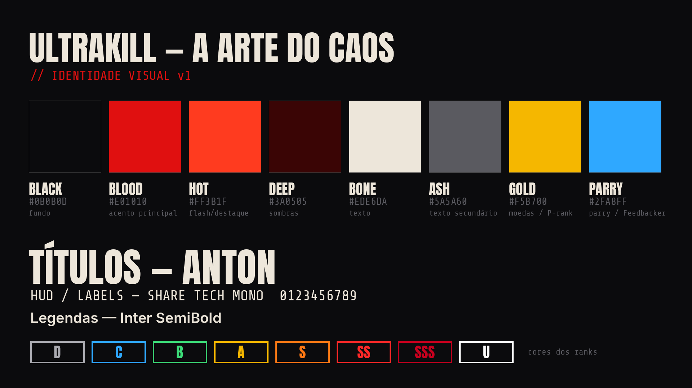

# Plano de produção — ULTRAKILL: A ARTE DO CAOS

Este documento transforma o [roteiro](01_ROTEIRO.md) e o animatic em vídeo final. Siga na ordem.

---

## 1. O que já está pronto e o que falta

| Item | Status | Arquivo |
|---|---|---|
| Roteiro com falas, tempos, imagens e sons | ✅ pronto | `docs/01_ROTEIRO.md` |
| Animatic com toda a camada gráfica, legendas e trilha no tempo final | ✅ renderizado (1080p local; 720p no repositório) | `output/ULTRAKILL_animatic_v1_720p.mp4` |
| Trilha original de 180 BPM (stem de música, stem de efeitos e mix) | ✅ gerada | `output/audio/*.flac` |
| EDL para Resolve/Premiere com 229 planos, já cortados na batida | ✅ pronta | `edit/ULTRAKILL_timeline.edl` |
| Narração em SRT (guia do locutor e legenda) | ✅ pronta | `edit/narracao.srt` |
| Planilhas: planos, textos, marcadores, lista de captura | ✅ prontas | `edit/*.csv` |
| Prancha de identidade visual | ✅ pronta | `assets/style_board.png` |
| **Gravações de gameplay (G01–G28)** | ❌ **precisa gravar** | seção 4 |
| **Logo oficial e arte de V1 (A01, A02)** | ❌ **precisa baixar do material oficial** | seção 7 |
| **Locução** | ❌ **precisa gravar** (não havia síntese de voz disponível neste ambiente, e uma voz robótica iria contra o briefing) | seção 6 |

> No animatic, **nenhum frame de gameplay é real**. Os blocos vermelhos com códigos (G13, G20a…) mostram exatamente qual gravação entra em cada ponto.

---

## 2. Identidade visual

### Paleta
| Nome | HEX | Uso |
|---|---|---|
| BLACK | `#0B0B0D` | Fundo dos cards. Nunca use preto puro, exceto nos cortes para silêncio. |
| BLOOD | `#E01010` | Acento principal: faixas, sublinhados, tags, moldura. |
| HOT | `#FF3B1F` | Flash de impacto em cima de vermelho. |
| DEEP | `#3A0505` | Sombras e gradientes de fundo. |
| BONE | `#EDE6DA` | Todo texto principal (branco "sujo", menos digital). |
| ASH | `#5A5A60` | Texto secundário e metadados. |
| GOLD | `#F5B700` | **Só** para moedas e P-Rank. |
| PARRY | `#2FA8FF` | **Só** para parry, em momentos pontuais. |

**Regra de ouro:** cada quadro tem no máximo **1 cor de acento** além do vermelho.

### Tipografia (todas com licença OFL ou livre, incluídas em `assets/fonts`)
- **Anton**: títulos, tags e cards. Sempre em CAIXA ALTA, com tracking 0.
- **Share Tech Mono**: labels técnicos e lower thirds, com cara de HUD.
- **Inter SemiBold**: legendas, em 40 px a 1080p, sobre caixa preta com 80% de opacidade.

### Linguagem de movimento
| Elemento | Regra |
|---|---|
| Tags (DASH, SLIDE…) | Entram pela esquerda em 4 frames (ease-out cúbico), inclinadas a 11°, sobre faixa vermelha, e saem no corte seguinte, sem animação de saída. |
| Cards grandes | Escala de 115% para 100% em 5 frames. O sublinhado cresce do centro. |
| Título | Escala de 125% para 100% em 6 frames. A sombra vermelha fica deslocada 12 px. A faixa entra 1 batida depois. |
| Impactos | Shake de até 28 px decaindo em cerca de 6 frames, RGB split de até 16 px e flash (vermelho para impactos médios, branco para os fortes). Use as intensidades da coluna `marcadores.csv`. |
| Ranks | Caixa no canto direito, escala de 125% para 100% em 3 frames, cor por rank (ver prancha). São **gráficos próprios inspirados** no medidor, não cópia do HUD do jogo. |
| Textura | Grão de filme sempre ligado (bem leve), scanlines de 14% só sobre gameplay e vinheta de 35%. |

### Color grading da gameplay
1. Contraste +10, pretos levemente esmagados (lift –0,03).
2. Saturação do vermelho +8, laranjas +4, demais cores –5.
3. Na Cena 4 (atmosfera): saturação –15 e um leve teal nas sombras, para os vermelhos dos chefes saltarem no drop.
4. Nunca altere a cor do HUD original a ponto de mudar a leitura do jogo.

---

## 3. Plano de cenas e transições

| Cena | Tempo | Ritmo de corte | Transição de entrada | Ideia central |
|---|---|---|---|---|
| C1 Cold open | 0:00–0:16 | preto → 2 batidas → 1 batida | — | Gancho: silêncio e depois explosão |
| C2 O que é | 0:16–1:04 | 4 s por plano, cards de 3,3 s | Impacto no título | Contexto e a premissa do sangue |
| C3 A arte do caos | 1:04–2:24 | 1–2 batidas | **Drop** no card "A ARTE DO CAOS" | Uma mecânica por bloco, nome na tela e corte na batida |
| C4 O Inferno | 2:24–3:28 | 5–6 s com dissolve → **1 batida** | Corte seco para o drone | Respiro atmosférico e retorno abrupto em 3:12 |
| C5 Viciante | 3:28–4:24 | 4–12 s | Corte no impacto | Análise: nota → repetição → maestria → performance |
| C6 Encerramento | 4:24–5:12 | 2 → 1 batida → silêncio | Corte no impacto | Catarse, frase final e logo |

**Transições especiais**
- **Corte para silêncio** (0:12.67, 2:23.67, 3:10.67 e 4:56): áudio a zero no frame exato, sem fade. É o que dá força ao que vem depois.
- **Whip pan** (0:45.33): desfoque direcional de 4 frames + whoosh.
- **Dip to black** (3:02 e 3:06.33): 10 frames.
- **Freeze-frame com linhas** (1:44.67): congele 2 batidas e desenhe linhas douradas de 4 px ligando as moedas, na ordem do ricochete.
- **Rewind** (2:00): volte 6 frames com efeito de fita e repita o soco.

---

## 4. Lista de captura

A lista completa e gerada automaticamente está em `edit/lista_de_captura.csv`, com quantas vezes cada gravação aparece e quanto tempo ocupa no vídeo.

### Configurações de gravação (todas as tomadas)
- **OBS**: 1920×1080 ou 2560×1440, **60 fps** (para câmera lenta limpa), CQP 16–18 ou bitrate ≥ 50 Mbps.
- **No jogo**:
  - **Volume da música: 0.** A trilha do vídeo é outra. Gravar com o OST ligado mistura uma música protegida nas tomadas e impede a troca de trilha.
  - **Efeitos sonoros: 100%.** Armas, parries, moedas e inimigos são essenciais.
  - FOV fixo em todas as tomadas, para a montagem não "pular".
  - HUD **ligado** nas tomadas de combate e **desligado** nas tomadas G20 (ambientes). Confira as opções de HUD da sua versão.
- **Nomeie os arquivos exatamente** como o ID: `G01.mov`, `G13.mov`, `G20a.mov`… Assim o relink da EDL é automático.
- Grave **de 3 a 5× mais** do que o tempo indicado na planilha. A EDL já avança o ponto de entrada a cada uso, para não repetir frames.

### Resumo
| ID | O que | Onde gravar |
|---|---|---|
| G01 | Primeiro combate em 1-1 | Limbo |
| G04 | Cura por sangue (queima-roupa) | qualquer fase / Sandbox |
| G05–G08 | Dash, slide, wall jump, slam | Sandbox ou arena aberta |
| G09 | Movimento encadeado, 20–30 s | Cyber Grind / camada 7 |
| G10–G11 | As 5 armas e suas variantes | Sandbox ou fase |
| G12–G14 | Moeda, corrente de moedas, railcoin | **Sandbox** (repita até sair perfeito) |
| G15–G17 | Parry de projétil, projectile boost, parry corpo a corpo | fases / chefes |
| G18–G19 | Medidor de estilo subindo / freshness caindo | Cyber Grind |
| G20a–f | Ambientes de cada camada, sem combate | camadas 1–7 |
| G21 | Filth, Stray, Malicious Face, Mindflayer | Sandbox (braço spawner) ou fases |
| G22–G23 | V2 (1-4), Gabriel (3-2) e trecho intenso de chefe | fases dos chefes |
| G24 | Tela de resultado comum e com P-Rank | fim de fase |
| G25 | **O mesmo encontro 3×**: ruim, média e a melhor | mesmo checkpoint |
| G26–G27 | Cyber Grind e Sandbox | — |
| G28 | Clipes de alto nível | seus, ou de criadores **com autorização por escrito** |

> **Spoilers:** a Cena 4 mostra só os chefes V2 e Gabriel, que aparecem cedo na campanha. Evite chefes secretos e finais de ato.

---

## 5. Montagem passo a passo (DaVinci Resolve; Premiere é análogo)

1. **Projeto**: 1920×1080, **30 fps** (a EDL está em 30 fps NDF).
2. Importe o animatic (`output/ULTRAKILL_animatic_v1.mp4`, gerado por `tools/render_animatic.py`, ou a versão 720p), `output/audio/*.flac` e as gravações `G*.mov` e `A*.png`.
3. **File → Import → Timeline → `edit/ULTRAKILL_timeline.edl`**. Os 229 planos entram cortados na batida. Os clipes `ANIM` usam o próprio animatic para os cards, e os demais ficam offline até o relink.
4. **Relink** para as pastas das gravações. Se o nome do arquivo for igual ao ID, o relink acontece de uma vez.
5. Coloque o **animatic numa trilha acima, com 30% de opacidade**, como referência. Desligue-o no fim.
6. Ajuste o **ponto de entrada (slip)** de cada plano para que a **ação caia no primeiro frame do corte**: o tiro, o soco ou a moeda acontece na batida. É isso que faz a edição "acompanhar a gameplay".
7. Importe `edit/marcadores.csv` como marcadores (ou copie à mão) e aplique o pacote de impacto (shake, RGB split e flash, ver seção 2) em cada marcador `IMPACTO`.
8. Refaça os textos na ferramenta do editor (Fusion / Essential Graphics) com as fontes de `assets/fonts`, seguindo `edit/textos_na_tela.csv`. Ou use os cards do animatic diretamente, já que estão no tempo e em 1080p.
9. Substitua o placeholder do logo pelo **A01 oficial**.
10. **Grade** (seção 2) e **mix** (seção 6).

---

## 6. Som, narração e mixagem

### Camadas (de baixo para cima)
1. **Música**: `music_stem.flac` (ou a trilha licenciada que a substituir; ver seção 7).
2. **Som original do jogo**: o áudio das próprias tomadas. É a camada mais importante para a credibilidade.
3. **SFX de edição**: `sfx_stem.flac`, com impactos, whooshes, risers, bips de UI, a moeda e o clang de parry sintetizados. Use-os **por cima** do som do jogo, não no lugar.
4. **Narração**.

### Níveis de referência (YouTube)
| Trilha | Nível |
|---|---|
| Master final | **–14 LUFS integrado**, true peak ≤ –1 dBTP |
| Narração | picos em –6 dBFS, média em –16 LUFS. Compressão 3:1, de-esser e EQ com HPF em 80 Hz |
| Música sob narração | **–6 dB de ducking** (sidechain da voz, ataque de 120 ms e release de 200 ms) |
| Música sem narração | volume cheio. Os momentos sem fala são o "palco" da trilha |
| Som do jogo | –8 a –12 dB abaixo da música nas montagens. Sobe para a frente em G04 (cura), G12–G14 (moedas), G15–G17 (parry) e nos disparos das armas na Cena 3.2 |

### Momentos de áudio que não podem falhar
- **Silêncios** em 0:12.67, 2:23.67, 3:10.67 e 4:56: zero absoluto, inclusive o som do jogo.
- **1:40**: a música esvazia e o "ding" da moeda fica sozinho na frente.
- **3:12**: o drop precisa ser o momento mais alto do vídeo até então.
- **4:57–5:02**: só voz e impactos, sem música.

### Locução
- Grave pelo `edit/narracao.srt`. Cada fala tem início e fim e cabe no tempo em ritmo natural (≤ 19 caracteres/s).
- Microfone dinâmico ou condensador em sala tratada, a 15 cm, com pop filter, 48 kHz / 24 bit.
- Faça 3 takes de cada fala. Grave as falas de uma palavra ("Dash.", "Slide."…) separadas.

---

## 7. Direitos autorais e uso de material

**Música**
- **A trilha incluída neste projeto é original**: foi sintetizada do zero em `tools/make_music.py`, sem samples de terceiros. Você pode usá-la no vídeo final, inclusive monetizado.
- **O OST oficial** (Heaven Pierce Her e outros) tem direitos dos autores/publicadora. **Não use sem autorização.** Para usá-lo, peça permissão por escrito.
- **Alternativas licenciadas** com a mesma energia (breakcore, metal eletrônico, industrial): bibliotecas por assinatura como Epidemic Sound ou Artlist (confira se a licença cobre YouTube monetizado), ou uma trilha encomendada a um produtor. Se trocar a música, **mantenha 180 BPM** ou reajuste `BPM` em `tools/timeline.py` e rode os scripts de novo.

**Gameplay e marca**
- Gravações do próprio jogo para crítica/análise são prática comum, mas **verifique a política oficial da New Blood Interactive para criadores de conteúdo** antes de monetizar.
- **Logo e key art** (A01, A02): use só os do material de imprensa oficial / página da Steam, nos termos indicados ali.
- **Clipes de outros jogadores** (G28): só com autorização por escrito e com crédito na tela e na descrição.

---

## 8. Exportação

- **H.264 ou H.265**, 1920×1080, 30 fps, 40–60 Mbps VBR (ou **4K upscale** para receber o codec VP9 do YouTube, que preserva melhor grão e cortes rápidos).
- Áudio AAC 320 kbps, 48 kHz.
- Legenda: envie `edit/narracao.srt` separada (a legenda queimada do animatic é só referência).
- Thumbnail: card "A ARTE DO CAOS" sobre o frame mais forte de G13 (corrente de moedas), seguindo a prancha de cores.

---

## 9. Checagem de fatos antes de publicar

O roteiro só afirma o que é central e estável no jogo. Como ULTRAKILL recebe atualizações, **confira na versão atual**:

- [ ] Nomes dos ranks de estilo: Destructive, Chaotic, Brutal, Anarchic, Supreme, SSadistic, SSShitstorm, ULTRAKILL.
- [ ] Requisitos do P-Rank (S em todas as categorias e sem morrer).
- [ ] Nomes de inimigos e chefes exibidos na tela (Filth, Stray, Malicious Face, Mindflayer, V2, Gabriel).
- [ ] Título de Gabriel na luta mostrada ("Judge of Hell" na primeira luta).
- [ ] Nomes e número das camadas lançadas na versão que você gravar. O roteiro cita até Violência e não fala do estado de lançamento do jogo, para não envelhecer.
- [ ] Créditos: Arsi "Hakita" Patala (criador) e New Blood Interactive (publicadora). Heaven Pierce Her é o compositor principal da trilha.

---

## 10. Checklist final

- [ ] Todos os G* gravados com a música do jogo em 0
- [ ] Relink completo, nenhum clipe offline
- [ ] Ação de cada plano no primeiro frame do corte
- [ ] Impactos aplicados em todos os marcadores
- [ ] Locução gravada, editada e com ducking
- [ ] Silêncios absolutos nos 4 pontos marcados
- [ ] Logo oficial no lugar do placeholder
- [ ] Master em –14 LUFS / –1 dBTP
- [ ] Créditos na descrição: jogo, desenvolvedor, publicadora, trilha e clipes de terceiros
